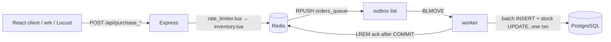

# FlashLock (PERN)

High-frequency atomic inventory engine for flash sales, ported from Django to **PostgreSQL · Express · React · Node.js**.

Redis (Lua) makes the sell/don't-sell decision atomically in the **hot path**; a worker relays completed orders
to PostgreSQL in the **cold path** using a Transactional Outbox. Two slower endpoints (naive and row-locking)
are kept so you can compare them against the Redis path.



## Layout

```
server/            Express API + workers
  sql/schema.sql   tables (replaces Django migrations)
  src/lua/         inventory.lua, rate_limiter.lua   (unchanged from the Django project)
  src/purchase.js  hot path: rate limit + inventory script
  src/routes.js    the 3 purchase endpoints + GET /items/:id, /health
  src/workers/     reliable.js · unsafe.js · slow.js
client/            React (Vite) demo UI
load_tests/        burst.mjs, locustfile.py, wrk/*.lua
```

## Run it

Requires Node 20+, Docker (or local Postgres 14+ and Redis 6.2+; `BLMOVE` needs 6.2).

```bash
docker compose up -d

cd server
cp .env.example .env
npm install
npm run migrate            # create tables
npm run seed -- 10000      # item + stock in both Postgres and Redis (replaces the Django shell / redis-cli steps)
npm start                  # API on :8000
```

In a second terminal, start **one** worker:

```bash
npm run worker             # reliable: batched, crash-safe (the intended solution)
npm run worker:unsafe      # BLPOP: loses orders if it crashes mid-batch (demo)
npm run worker:slow        # one transaction per order (demo)
```

Third terminal, the UI:

```bash
cd client && npm install && npm run dev      # http://localhost:5173 (proxies /api → :8000)
```

## Benchmarking

```bash
node load_tests/burst.mjs high_speed 500                    # 500 concurrent users, tallies statuses + final stock
python -m locust -f load_tests/locustfile.py --headless -u 500 -r 500 -t 30s --host http://127.0.0.1:8000
wrk -t4 -c500 -d30s -s load_tests/wrk/purchase_high_speed.lua --latency http://127.0.0.1:8000
```

Run the load generator on a different machine from the API for meaningful numbers.
For multi-core use, run several API processes behind a load balancer or PM2 cluster mode (Node is single-threaded per process).

## What changed from the Django version

| Django | PERN |
| --- | --- |
| Django views, `orjson`, Waitress/Gunicorn | Express 5 (`express.json`), single Node process |
| Django ORM models + migrations | `pg` + `sql/schema.sql` (tables `inventory_items`, `orders`) |
| `redis-py` `BlockingConnectionPool` + `register_script` | `ioredis` (pipelines over one connection) + `defineCommand` (EVALSHA) |
| `manage.py process_outbox` / `BLMOVE_process_outbox` | `npm run worker` (the two were equivalent; `BRPOPLPUSH` is deprecated, so one BLMOVE worker) |
| `error_process_outbox` / `slow_process_outbox` | `worker:unsafe` / `worker:slow` |
| Manual seeding in shell + `FLUSHALL` | `npm run seed` (clears only FlashLock keys) |
| — | React UI, `GET /api/items/:id`, `GET /api/health` |

Endpoints, status codes, Redis key names, outbox payload format and both Lua scripts are unchanged.

### Bugs fixed while porting

- **`print()(...)` in the high-speed view** raised `TypeError` on every duplicate purchase, so users got a 500 instead of the intended 409.
- **BLMOVE worker acknowledged with `rpop(key, 1, value)`**, which isn't a valid remove-by-value call. It's now `LREM`.
- **Naive view** called `Order.objects.get()` without handling `DoesNotExist`, so it crashed for first-time buyers. It now behaves as intended (and still oversells; that's the point).
- **Both `wrk` Lua scripts** for naive/transactional had syntax errors, and the high-speed one set the header incorrectly. All three are fixed and live in `load_tests/wrk/`.
- **Input validation**: `user_id`/`item_id` must be positive integers. The Lua script builds its JSON payload by string concatenation, so an unvalidated string could corrupt the outbox message.

### Behaviour additions

- **The worker now recovers on startup.** The README claimed crash resilience, but nothing ever moved stranded `processing_queue` messages back. It does now.
- **`orders` has `UNIQUE (user_id, item_id)`** and the worker uses `ON CONFLICT DO NOTHING`, counting only inserted rows when deducting stock. A replayed batch can't double-create orders or double-deduct stock.
- Recovery assumes a **single worker** (a second one starting would re-queue the first's in-flight batch; the idempotent insert keeps that safe for data, but it's wasted work).

### Left as-is (worth a look)

- **Rate limiter TTL**: `EXPIRE` is `ceil(capacity / refill_rate * refill_interval / 1000)` = 1 second with the default settings, so a user's bucket is deleted after ~1s and effectively resets. Check the intended unit; the `/ 1000` looks like a milliseconds leftover. I left `rate_limiter.lua` byte-identical.
- **Unknown item ids** on the high-speed path return 500 ("Redis error"), because the Lua script errors on a missing stock key. Same as the original.
- **Secrets**: the Django `settings.py` has a hard-coded Postgres password and `SECRET_KEY`. Rotate them if they were ever used for anything real. This port reads config from `.env`.
- `load_tests/comp_orjson_n_trad.py` (orjson vs `json` micro-benchmark) was dropped since it's Python-specific.
